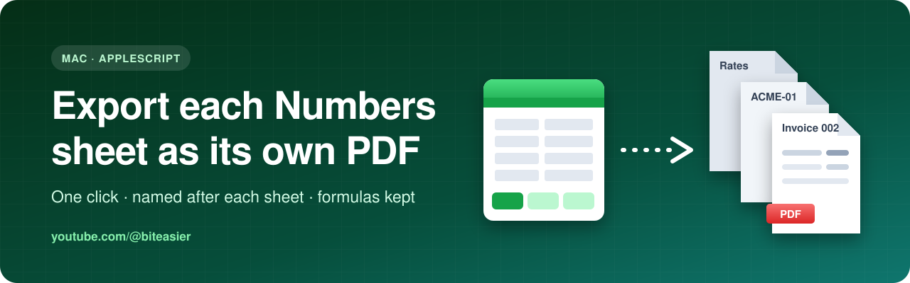

 

**Free scripts from my YouTube videos. Download, run, done.**

---

## 🎬 Tutorials

<table>
  <tr>
    <td width="100%">
      
      <h3>🍎 <a href="numbers-sheets-to-pdf/">Export each Numbers sheet as a separate PDF</a></h3>
      
Numbers can only export the whole file. This AppleScript turns <b>every sheet into its own PDF</b>, named after the sheet, and keeps formulas that use other sheets working.

      

        
        
        
        &nbsp;📺 <i>Video coming soon</i>
      

    </td>
  </tr>
</table>

> 🔔 **More tutorials are on the way:** Power Automate flows, Mac automation and more. [Subscribe on YouTube](https://www.youtube.com/@biteasier?sub_confirmation=1) so you don't miss them.

## ✨ What you get in every tutorial

<table>
  <tr>
    <td align="center" width="33%">📜 <b>The script</b> Ready to run, with comments that explain each step</td>
    <td align="center" width="33%">🧪 <b>A demo file</b> Try it safely before using your own files</td>
    <td align="center" width="33%">📖 <b>A guide</b> Step-by-step setup, tips and troubleshooting</td>
  </tr>
</table>

## ⬇️ How to download

| I want… | Do this |
|---|---|
| **One file** | Open the tutorial folder, click the file, then click **⤓ Download raw file** at the top right |
| **Everything** | Click the green **`<> Code`** button at the top of this page, then **Download ZIP** |

## 💬 Questions or ideas?

Ask in the comments under the video on [YouTube](https://www.youtube.com/@biteasier), or [open an issue](../../issues) here. Got a boring task you'd like automated? Tell me, and it might become the next tutorial.

## 📄 License

[MIT](LICENSE): free to use and change, including for work. Scripts come with no warranty, so always test on a copy of your files first.

---

**If a script saved you time, ⭐ star this repo and [subscribe on YouTube](https://www.youtube.com/@biteasier?sub_confirmation=1)!**

