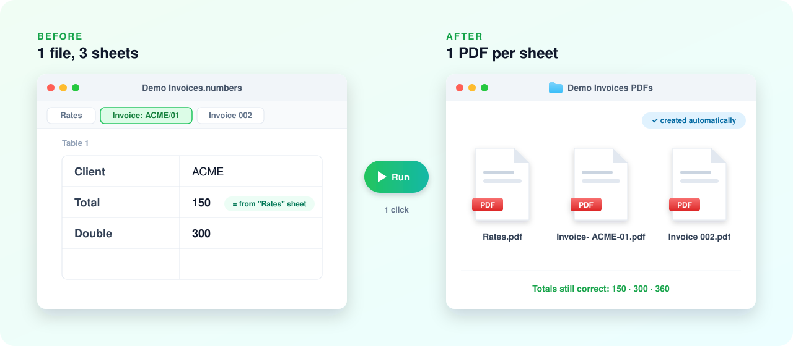

# YouTube Tutorials

Free, ready-to-use automation scripts from the **[@biteasier](https://www.youtube.com/@biteasier)** YouTube channel. 
Power Automate · Power Apps · n8n · Mac automation

  

**[Tutorials](#tutorials)** · **[How to use](#how-to-use)** · **[Download](#download)** · **[Request a tutorial](../../issues/new)**

---

## Tutorials

<table>
  <tr>
    <td width="40%" valign="top">
      
    </td>
    <td width="60%" valign="top">
      <h3><a href="numbers-sheets-to-pdf/">Export each Numbers sheet as a separate PDF</a></h3>
      
MAC · APPLESCRIPT · NUMBERS

      
Numbers can only export the whole file. This script turns every sheet into its own PDF, named after the sheet, and keeps formulas that use other sheets working.

      
<a href="numbers-sheets-to-pdf/"><b>Open tutorial →</b></a> &nbsp;·&nbsp; Video coming soon

    </td>
  </tr>
</table>

### Coming next

- Return a table from Power Automate to Power Apps
- Extract email table data when the columns change (Power Automate)
- Extract data from PDF attachments with AI (Power Automate)

[Subscribe on YouTube](https://www.youtube.com/@biteasier?sub_confirmation=1) to get them first.

## How to use

Every tutorial folder has the same layout:

| File | What it's for |
|---|---|
| `README.md` | Requirements, step-by-step setup, options and troubleshooting |
| The script or formulas | Ready to run; the comments explain each step |
| A demo file | Lets you try it safely before using your own files |

1. Read the tutorial's README.
2. Try it on the **demo file**.
3. Run it on a **copy** of your own files.

## Download

| I want | Do this |
|---|---|
| One file | Open it on GitHub, then click **Download raw file** (top right) |
| Everything | Click **Code › Download ZIP** at the top of this page |

## Questions and requests

- **About a video:** comment on [YouTube](https://www.youtube.com/@biteasier).
- **A script doesn't work:** [open an issue](../../issues).
- **Want something automated?** [Suggest a tutorial](../../issues/new). It might be the next video.

## License

[MIT](LICENSE): free to use and change, including for work. The scripts come with no warranty, so test on a copy of your files first.

 
Made by <a href="https://www.youtube.com/@biteasier">@biteasier</a> · If a script saved you time, star the repo

