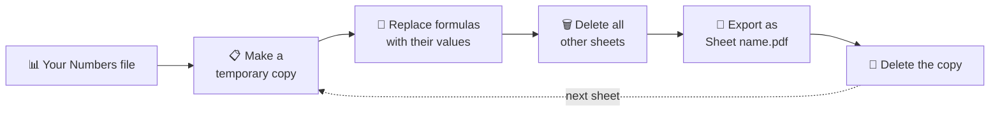

<div align="center">

# 🍎 Export Each Numbers Sheet as a Separate PDF

**One Numbers file in → one PDF per sheet out, each named after its sheet.**


<a href="https://www.youtube.com/@biteasier?sub_confirmation=1"></a>

</div>

---

## 🤔 The problem

In Apple Numbers, **File › Export To › PDF** always puts **every sheet into one PDF**. There's no option to export just one sheet, let alone every sheet as its own file.

If your file has an invoice or a report on each sheet, you'd have to print them one by one and type every file name yourself.

## ✨ The solution

This script does all of it in **one click**:

- 📄 **One PDF per sheet**, named after the sheet
- 🧮 **Formulas keep working**, even totals that come from **other sheets**
- 📁 **Creates the folder for you**, right next to your Numbers file
- 🔒 **Your original file is never changed**
- ⏳ **Shows progress** while it works

## 🔄 Before and after

```
📁 My Folder                            📁 My Folder
└── 📊 Demo Invoices.numbers     ──▶    ├── 📊 Demo Invoices.numbers
    ├── Rates                           └── 📁 Demo Invoices PDFs   ← created automatically
    ├── Invoice: ACME/01                    ├── 📄 Rates.pdf
    └── Invoice 002                         ├── 📄 Invoice- ACME-01.pdf
                                            └── 📄 Invoice 002.pdf
```

> Characters that aren't allowed in file names (`/` `:` `\`) are replaced with `-`.

## ⚙️ How it works

Numbers can't export a single sheet, so for **each sheet** the script works on a temporary copy:



**Why replace formulas?** If an invoice's total comes from another sheet (like a price list), deleting that sheet would break the formula. Replacing formulas with their current values first keeps every number correct, including its currency, percentage or date format.

## 🚀 Quick start

1. **Download** [`Export Sheets to PDF.applescript`](Export%20Sheets%20to%20PDF.applescript) and open it in **Script Editor** (Applications › Utilities).
2. **Pick your Numbers app.** The script is set to **Numbers Creator Studio**. If you use the free **Numbers** app, change this line:

   ```applescript
   tell application "Numbers Creator Studio"
   ```
   to:
   ```applescript
   tell application "Numbers"
   ```
3. **Open your Numbers file.** It must be saved, and it should be the only document open.
4. In Script Editor, click **▶ Run**.
5. The first time, macOS asks whether Script Editor may control Numbers. Click **OK**.

That's it. When it's done, click **Show in Finder** to open your PDFs. 🎉

> 🧪 **Try it first** with [`Demo Invoices.numbers`](Demo%20Invoices.numbers). Its invoice totals come from the "Rates" sheet, so you can see the formulas survive.

## 🧰 Options and tips

<details>
<summary><b>Skip some sheets</b></summary>

<br>

To leave out sheets like "Input" or "Settings", add their names at the top of the script:

```applescript
property sheetsToSkip : {"Input", "Settings"}
```

</details>

<details>
<summary><b>Run it with a double-click (as an app)</b></summary>

<br>

1. In Script Editor, choose **File › Export…**
2. Set **File Format** to **Application** and save it, for example to your Desktop or Dock.
3. Open your Numbers file, then double-click the app.

</details>

<details>
<summary><b>Run it from the menu bar</b></summary>

<br>

1. In Script Editor, open **Settings › General** and turn on **Show Script menu in menu bar**.
2. Put the script in `~/Library/Scripts`.
3. Open your Numbers file and pick the script from the 📜 menu bar icon.

</details>

## 🩺 Troubleshooting

| Problem | Fix |
|---|---|
| *Script Editor asks "Where is Numbers Creator Studio?"* | You have the free Numbers app. Click Cancel and change the `tell application` line (see step 2). |
| *"Open a Numbers document first"* | Open your file in Numbers before clicking Run. |
| *"Save the document first"* | Save your file once (⌘S), then run again. |
| *Nothing happens / "not allowed to send Apple events"* | System Settings › Privacy & Security › **Automation**: allow Script Editor to control Numbers. |
| *Old PDFs are replaced* | That's expected: running it again overwrites PDFs with the same name. |
| *A PDF has several pages* | That sheet is longer than one page. Every sheet still gets its own file. |

## 📌 Good to know

- Big files take longer, because the script opens one copy per sheet. Don't click around in Numbers while it runs.
- Tested on macOS with **Numbers Creator Studio 15.4**. The free Numbers app uses the same scripting commands.

---

<div align="center">

📺 **More automation tutorials on [YouTube](https://www.youtube.com/@biteasier?sub_confirmation=1)** · ⭐ **Star the repo if it helped!**

[← Back to all tutorials](../)

</div>
